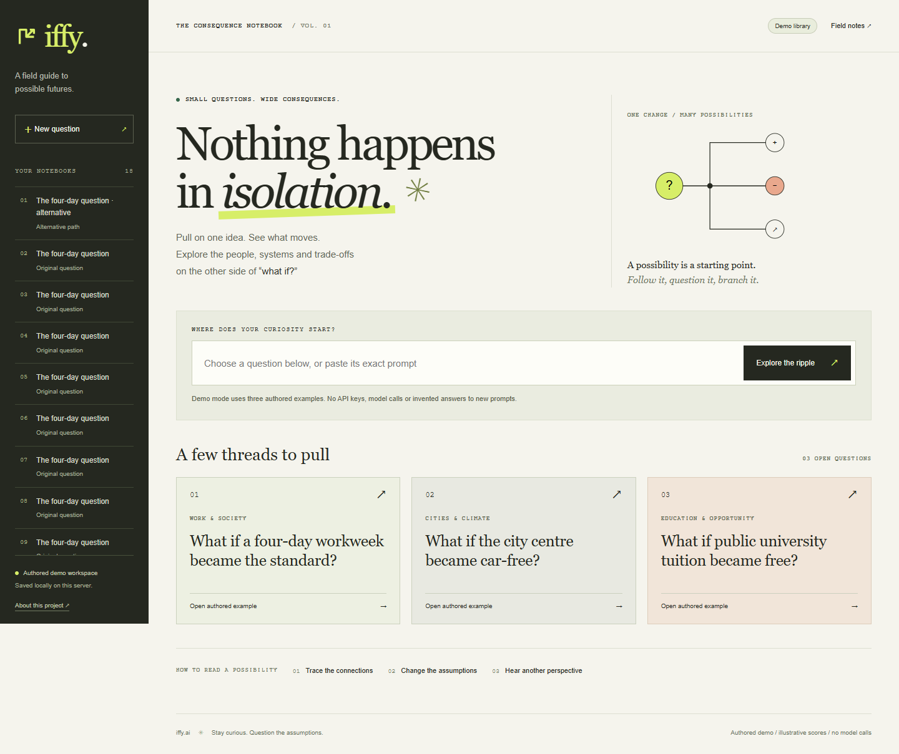
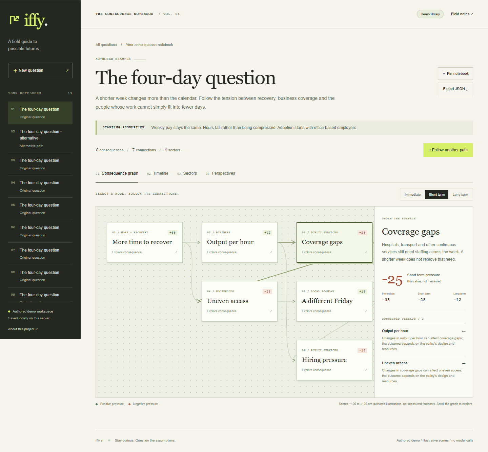
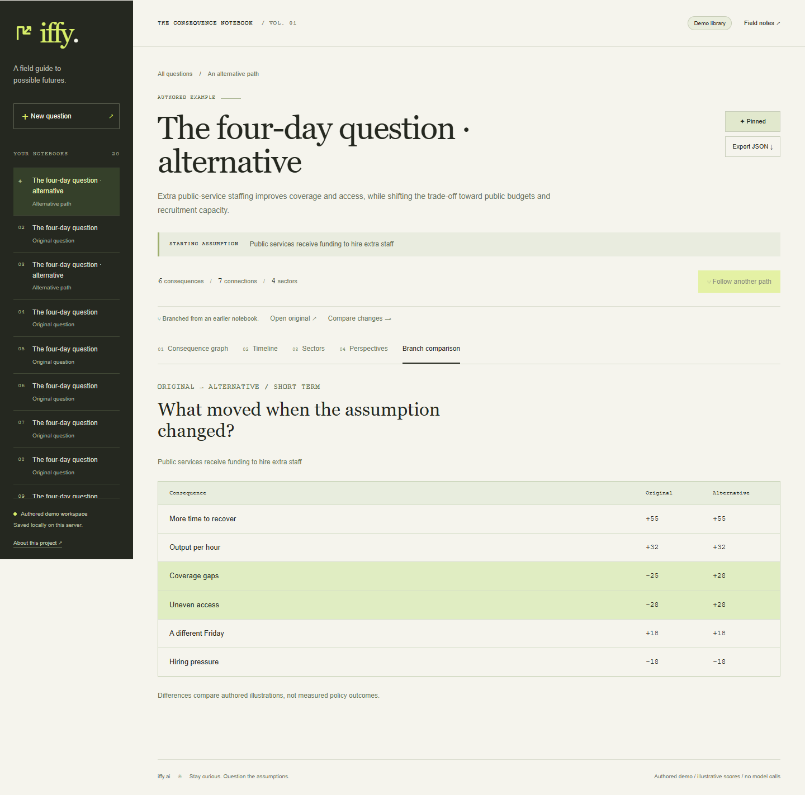
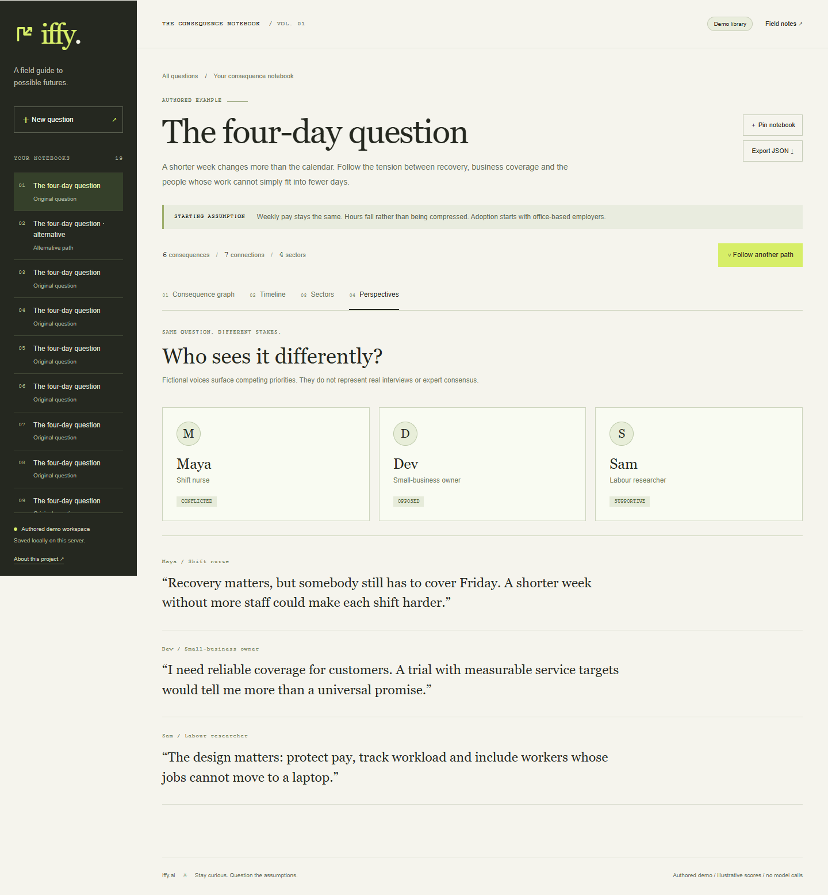
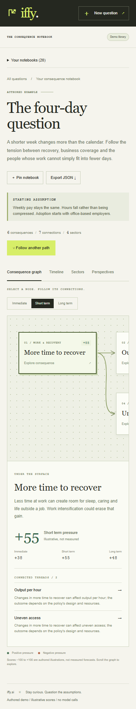
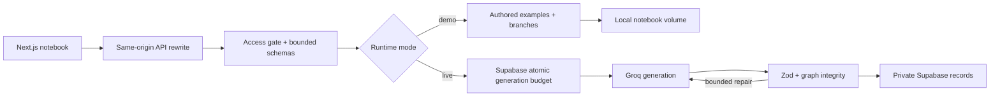

<div align="center">

# iffy.ai — The consequence notebook

**Pull on one idea. See what moves.**

Explore “what if?” questions through connected effects, time horizons and competing perspectives.<br/>
Change an assumption, follow a different path, and keep the original beside it.

[Try the notebook](#try-the-notebook) · [The workflow](#from-question-to-consequence) · [Development & live mode](docs/OPERATIONS.md) · [Team & history](docs/PROVENANCE.md)

</div>



A paragraph can make a hypothetical sound more settled than it is. iffy.ai turns it into something you can inspect: select a consequence, trace its connections, look at who benefits, and ask which assumptions made that outcome possible.

> [!NOTE]
> **The default is an authored demo you can run without credentials.** Three examples and their alternatives illustrate the workflow, with no model calls. Optional private live mode uses Groq and Supabase for new questions and requires your own configuration. Live provider usage and the old external deployment remain unverified. Neither mode is a calibrated forecasting tool.

## From question to consequence

| Look through… | Find… |
| --- | --- |
| **The consequence graph** | Selectable nodes, directed connections and explanations. Switch time horizons to see which illustrative effects change. |
| **The timeline** | Immediate adjustments, short-term adaptation and longer-term questions. |
| **Sector views** | Opportunities, trade-offs and a closer look at the systems involved. |
| **Perspectives** | Fictional voices with different stakes, rather than invented interviews or expert consensus. |
| **An alternative path** | A separately saved branch and a comparison against the original. The first notebook stays intact. |



The new notebook interface pairs a scrollable graph with a persistent question library. Notebooks survive a container recreation; browser pins help you find them again. JSON export keeps the graph, source mode and assumptions together.

## Try the notebook

Requires **Docker with Compose**; start Docker Desktop on Windows. Initial image/dependency downloads require internet. No provider credentials or environment file are needed.

```sh
git clone https://github.com/Muneer320/iffy-ai.git
cd iffy-ai
docker compose -p iffy-demo up -d --build --wait
```

Open **[localhost:5175](http://localhost:5175)**. API health: [localhost:8102/api/health](http://localhost:8102/api/health).

1. Open **“What if a four-day workweek became the standard?”**
2. Select **Coverage gaps**, switch between **Immediate** and **Short term**, and read the connection explanations.
3. Inspect **Timeline**, **Sectors** and **Perspectives**.
4. Choose **Follow another path**, select the public-service staffing alternative, then **Create alternative**. **Compare changes** shows what moved; **Open original** preserves the starting point.
5. Pin the notebook or **Export JSON**. Reload its URL to return to the saved graph.

The city-centre and tuition examples use different assumptions. The demo accepts those exact library prompts and one authored branch per original. Arbitrary questions, nested branches and debate follow-ups require live mode. Demo scores and personas are illustrative.



Stop with `docker compose -p iffy-demo stop`; the named notebook volume remains. Removing that volume deletes the demo notebooks. The [operations guide](docs/OPERATIONS.md#docker-demo) covers backup and storage limits.

<details>
<summary><strong>Perspectives and mobile views</strong></summary>

Captured from the running app using authored fixtures. Mobile puts saved notebooks in an expandable library; the graph scrolls within its own area.





</details>

<details>
<summary><strong>Architecture and optional private live mode</strong></summary>



The retained backend uses generation → validation → bounded repair. Simulations require at least **6 nodes, 5 edges, 4 sectors and 3 personas**, unique node/edge IDs and valid edge references. These checks establish coherent structure, not the truth of a causal claim.

Live mode requires a server-side passkey and both SQL migrations. Each provider attempt, including retries/repairs, consumes a shared **6/minute and 50/day** workspace budget; unavailable quota storage fails closed. The UI forwards a passkey held only in memory. No secret is injected to unlock anonymous model usage.

Migration 002 removes the original anonymous database-read policies. Existing deployments gain no protection until upgraded. See [live setup, privacy and verification limits](docs/OPERATIONS.md#optional-private-live-mode).

</details>

## Develop or contribute

Supported apps: `frontend/` and `backend/`, on Next.js 16 / React 19. Native development requires **Node 22.12+**; Docker and CI use Node 24. `frontend_v2/` is an unsupported sprint experiment.

The [operations guide](docs/OPERATIONS.md) gives the native setup and exact build, typecheck, regression, PostgreSQL and browser commands. CI checks both apps, the quota migration and the real Docker/browser demo. Preserve the demo/live distinction and include a reproducible check with behavior changes. [Issues and pull requests](https://github.com/Muneer320/iffy-ai/issues) are welcome.

Created for **ProdX @ NAVERA '26** by **[Muneer Alam](https://github.com/Muneer320)**, creator and team lead, with **[Amrit Kang](https://github.com/amritkang165)** and **Akshaj Garlapati**, mentored by **Anshuman Singh**. [History and contribution boundaries](docs/PROVENANCE.md) preserve the original team record. [MIT licensed](LICENSE).
