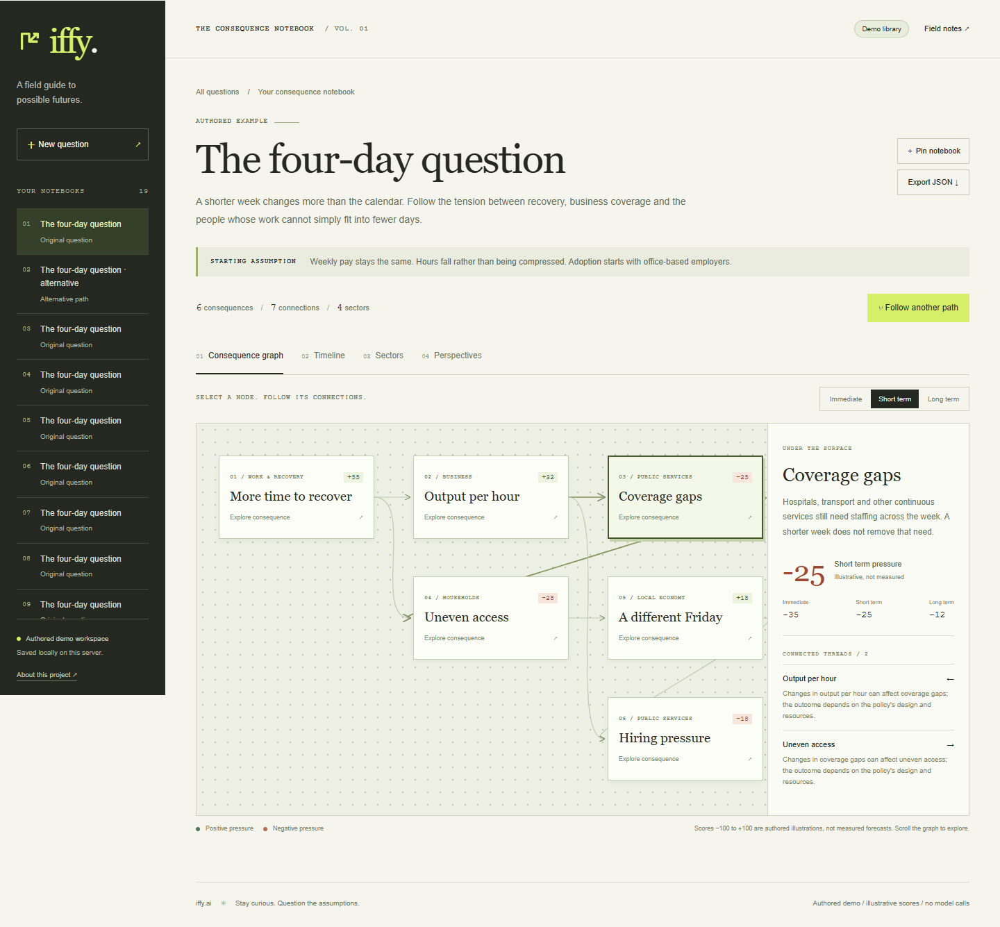

# The iffy.ai notebook

A new paper-and-ink interface for following consequences, comparing assumptions and hearing competing perspectives. This is [iffy.ai's](../README.md) supported frontend; `frontend_v2/` remains historical.



## Develop locally

Use **Node 22.12+**. Start the [backend](../backend/README.md), then:

```sh
cd frontend
npm ci
npm run dev
```

Open **http://localhost:5175**. `/api/*` rewrites to localhost:8102 by default. Set server-only `IFFY_BACKEND_URL` **before building** for another backend; see `.env.example`. The root Docker quickstart configures both apps.

Select nodes and follow connected threads; switch horizons, inspect timelines/sectors/perspectives, and create a separate branch. Compare it with its original or export its complete JSON. Server notebooks persist through the API; pins use optional browser storage. Mobile puts saved notebooks in the expandable **Your notebooks** menu. The live passkey stays in memory.

Unsupported demo prompts produce a clear error. Cancel waiting aborts the browser request, not provider work already accepted by the server.

## Check a change

```sh
npm run lint
npm run build
npm run typecheck
npx playwright install chromium
npx playwright test
```

Browser checks require the root Docker demo. `IFFY_CHROME_PATH` selects an existing local Chrome executable; `IFFY_UI_URL` selects another local UI. Screenshots use authored fixtures only.

[Operations and limits](../docs/OPERATIONS.md) · [Team/history](../docs/PROVENANCE.md) · [MIT license](../LICENSE)
